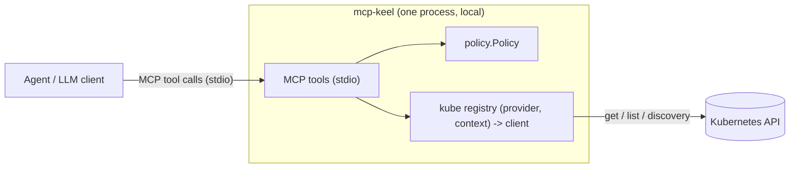
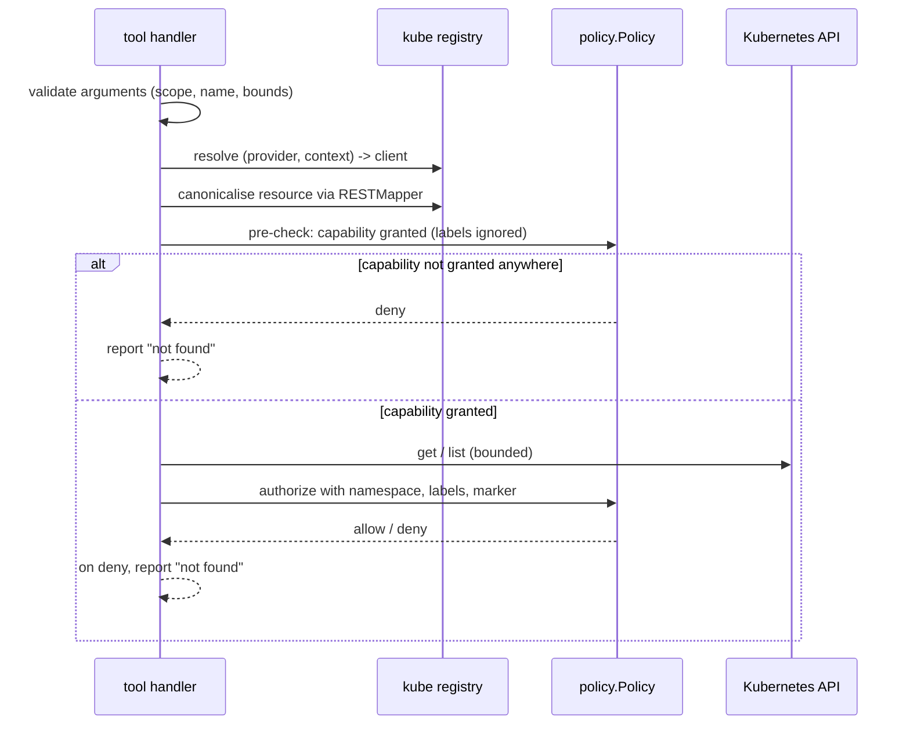

# Architecture

`mcp-keel` is a policy-governed MCP server for read-only Kubernetes access. It has a single entry point
(MCP tools over stdio) and one shared authorization core. No tool re-implements policy.

## One policy core

Every tool runs the same authorization path: the `policy.Policy` rule engine, plus the server-side
namespace-marker overlay, on the tuple

```
(provider, context, namespace, resource, verb, name, labels)
```

and gets a deny-by-default, firewall-style decision: a rule applies when its scope matches AND one of its
capabilities matches the request AND that capability's filters pass; the first applicable rule wins
(`allow` grants, `deny` denies). Entry-point-specific checks are **additive on top of** that decision:

- **Argument validation**: namespace vs. cluster scope, name, bounds, resource syntax.
- **Resource canonicalisation**: the tool argument is resolved through discovery/RESTMapper to one
  canonical form used for BOTH policy matching and the API call.
- **Label and marker checks**: object labels, and the optional namespace marker, are fail-closed.
- **Content redaction**: per-provider, post-authorization, over `get`/`list` string values (ADR 0015).
- **Output shaping**: `managedFields` pruning, object reduction and the response budget (ADR 0013).

Where a check cannot be performed (for example discovery fails, or an ambiguous resource name), the server
**fails closed** instead of relaxing the rule.

## Components



| Package           | Responsibility                                                              |
|-------------------|----------------------------------------------------------------------------|
| `internal/config` | YAML loading, defaults, validation, `Secret` redaction.                     |
| `internal/policy` | Capabilities, firewall rule engine, marker-exemption flag. Backend-agnostic.|
| `internal/kube`   | Cluster abstraction: kubeconfig loading, per-context clients, discovery.    |
| `internal/server` | MCP tools, argument validation, limits, error mapping.                      |

The policy package is pure (no I/O): it evaluates already-canonical resources and exposes the winning
capability's namespace-marker exemption on the decision. The server applies the marker overlay.

## Authorization pipeline



The pre-check uses only the dimensions known before the fetch (scope, `resource`, `verb`, and the name for
`get`): a matching scope-only `deny` rule denies here without an API call, otherwise the request proceeds
if some rule could grant the capability. The **final** decision runs after the object(s) are fetched, so
label filters and the namespace marker can be applied; the first applicable rule wins (ADR 0011). This
keeps the pre-check an optimization only - it never grants, and it never over-denies.

## Get flow

1. Validate `provider`, `context`, `resource`, `namespace`, `name`.
2. Canonicalise `resource` (fail-closed on ambiguity/unknown).
3. Pre-check with the dimensions known now: a scope-only `deny` denies; otherwise proceed if some rule
   could grant `resource:get`.
4. Fetch the object.
5. Full authorization with the object's labels (and the namespace marker if enabled); the first applicable
   rule wins.
6. On deny, report the object as **not found**; otherwise return the fetched object.

## List flow

1. Validate `provider`, `context`, `resource`, optional `namespace`, `limit`.
2. Canonicalise `resource`.
3. If `namespace` is given: pre-check for that namespace; otherwise check that some rule could grant
   `resource:list` anywhere for the provider/context.
4. Fetch a **bounded** window from the API server.
5. For each item, evaluate the ordered rules with the item's namespace and labels. Denied items are
   dropped and counted server-side only.
6. Return the items and a `truncated` flag for the caller's own window. The number of hidden items is
   never returned.

## Why fail-closed

- **Canonicalisation.** Kubernetes has many aliases (`deploy`, `deployments`, `Deployment`) and ambiguous
  names (`events` exists in core and `events.k8s.io`). If policy matching and the API call used different
  forms, a deny rule could be bypassed. Canonicalisation happens once, before matching, and ambiguity is
  rejected.
- **Wildcards.** `*` must mean "everything harmless", so it excludes subresources (never configurable) and
  a built-in sensitive set. A configurable allow-list would fail open when incomplete.
- **Cluster scope.** Cluster-scoped resources are selected by the literal `""` in a rule's `namespaces`,
  and `*` never matches `""`, so a namespace wildcard never grants cluster-scoped access.
- **Existence.** Denied, label-excluded and marker-protected objects answer identically to non-existent
  ones, so the server does not confirm that an object exists.

## Related documents

- `adr/0002-deny-by-default-capability-policy.md` — the rule model.
- `adr/0012-resource-canonicalization.md` — the canonicalisation algorithm.
- `adr/0004-cluster-scope-and-wildcard-safety.md` — scope and wildcard semantics.
- `adr/0013-output-truncation-and-limits.md` — output envelopes, truncation and the response budget.
- `adr/0014-kubernetes-client-and-discovery.md` — client config, discovery and caching.
- `adr/0015-content-redaction.md` — configured content redaction of tool results.
- `method-specs/redaction.md` — the redaction contract (path grammar, phases, caps).
- `config-reference.md` — the authoritative config field reference.
- `method-specs/authorization.md` — the shared pipeline; `method-specs/output.md` — output contract.
- `../AGENTS.md` — invariants; `../README.md` — user-facing overview.
